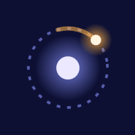

<p align="center">
  
</p>

<h1 align="center">Орбита</h1>

<p align="center">Аркада на одну кнопку: срывайся с орбиты звезды и лови кольцо следующей.</p>

<p align="center"><b><a href="https://temka0705.github.io/orbita-game/">▶ Играть</a></b></p>

---

## Как играть

Твоя точка крутится вокруг звезды. Жмёшь пробел, клик или тап — и она срывается по касательной. Влетел в пунктирное кольцо следующей звезды — тебя поймали, +1 очко. Прошёл близко к ядру — «идеально», растёт комбо. Улетел за экран — забег окончен.

## Что внутри

- **4 типа звёзд:** обычная, пульсар с «дышащим» кольцом, красный гигант, двойная система.
- **Чёрные дыры-рогатки:** раскручивают и швыряют точно в следующую звезду.
- **Туманности:** внутри видно только кольца.
- **Бонусы:** щит, магнит, замедление времени, ×2 очков.
- **Режимы:** бесконечный, на время (60 с), дзен, 8 испытаний.
- **29 ачивок** и **11 скинов** с разными формами и следами. Последний, «Сверхновая», — за все ачивки.
- **Работает офлайн** и ставится на главный экран телефона как приложение (PWA).

## Как поставить на телефон

- **iPhone:** открой сайт в Safari → «Поделиться» → «На экран „Домой“».
- **Android:** открой в Chrome → меню → «Установить приложение».

После первого запуска игра работает без интернета.

## Устройство проекта

| Файл | Что это |
|---|---|
| `src/orbita.html` | Исходник игры: вся логика, графика (Canvas 2D) и интерфейс в одном файле, без библиотек |
| `build.mjs` | Собирает `index.html` для сайта: добавляет оболочку страницы, манифест и офлайн-режим |
| `index.html` | Собранная страница, которую отдаёт хостинг |
| `sw.js` | Service worker: кэш для офлайна |
| `manifest.webmanifest`, `icons/` | Описание приложения и иконки для главного экрана |

Пересобрать после правок в `src/orbita.html`:

```
node build.mjs
```

Прогресс (рекорды, кристаллы, скины, ачивки) хранится в браузере на устройстве.

---

Сделано вместе с [Claude Code](https://claude.com/claude-code).
